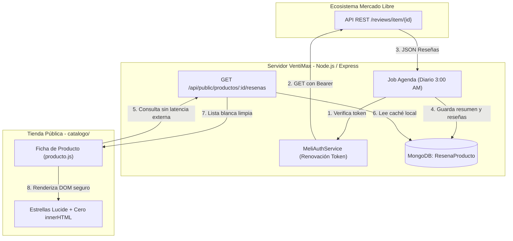

# Investigación: Reseñas Reales de Mercado Libre en la Tienda Web

> **Documento:** `docs/resenas-mercadolibre-investigacion.md`  
> **Tarea:** F2q — Investigación técnica, funcional y legal para integrar reseñas reales de Mercado Libre por API en la tienda pública (`catalogo/`).  
> **Fecha de investigación:** 2026-11-04  
> **Autor:** Antigravity (TPM)  
> **Estado:** Entregado para revisión de Claude (Cerebro)  
> **Alcance:** Solo investigación y diseño preliminar. Sin código de producción, sin dependencias nuevas ni credenciales reales en el repositorio.

---

## 1. Resumen Ejecutivo

El dueño de VentiMax solicitó evaluar la incorporación de las reseñas reales que sus productos acumulan en Mercado Libre Venezuela (`MLV`), mostrándolas en la ficha de cada artículo en la tienda web (`catalogo/`) mediante la API oficial.

### Hallazgos Principales:
1. **Existencia y vigencia de la API:** Mercado Libre cuenta con un recurso oficial dedicado a calificaciones de publicaciones: `GET https://api.mercadolibre.com/reviews/item/{item_id}` (documentación actualizada a septiembre de 2026). Este endpoint devuelve el promedio de calificación (`rating_average`), el desglose de estrellas (`rating_levels`), el número total de opiniones, los comentarios de texto (`content`, `title`, `rate`, `date_created`) y el material multimedia adjunto por los compradores (`media[]`: fotos y videos).
2. **Autenticación obligatoria (WAF & PolicyAgent):** No existe acceso anónimo ni público a la API. Toda petición sin cabecera `Authorization: Bearer <token>` es interceptada inmediatamente por el WAF de CloudFront y el PolicyAgent interno de Mercado Libre, devolviendo un error `403 Forbidden` (`PA_UNAUTHORIZED_RESULT_FROM_POLICIES`). Se requiere registrar una aplicación en el **Mercado Libre DevCenter** y completar el flujo de autorización **OAuth 2.0 (Authorization Code Grant)**.
3. **Disponibilidad para Venezuela (`MLV`):** La API opera de manera homogénea en todos los dominios de la plataforma, incluyendo el sitio de Venezuela (`MLV`, publicaciones tipo `MLV123456789`). Asimismo, el endpoint `GET /users/{user_id}` provee la reputación oficial del vendedor (`seller_reputation`: medalla de MercadoLíder, termómetro verde/amarillo/rojo y métricas de reclamos/despachos).
4. **Viabilidad legal y términos de uso:** Los Términos y Condiciones del Programa de Desarrolladores (cláusula 5.2) autorizan la exhibición del contenido de Mercado Libre en aplicaciones y sitios web de terceros mientras la publicación esté activa. Sin embargo, imponen dos obligaciones ineludibles:
   - **Regla de actualización de 24 horas (cláusula 5.3):** El desarrollador debe actualizar el contenido al menos una vez cada 24 horas y remover cualquier reseña o publicación dada de baja en Mercado Libre.
   - **Privacidad y datos personales (cláusula 6):** El campo `reviewer_id` en la API siempre devuelve `0`. La API jamás revela nombres, cédulas ni correos de los compradores; las reseñas se muestran como "Comprador verificado en Mercado Libre". El scraping está taxativamente prohibido (cláusula 7.6).
5. **Estrategia técnica recomendada:** **Cero llamadas en vivo desde el navegador del cliente.** Se propone un job periódico en Agenda (`actualizar-resenas-mercadolibre`) ejecutado una vez al día (p. ej. a las 3:00 AM hora de Caracas) que consulte los artículos configurados, guarde un resumen normalizado en MongoDB y lo exponga mediante una lista blanca estricta en `/api/public/productos/:id/resenas`. En la tienda se renderiza con íconos de Lucide y manipulación segura del DOM (`textContent`), con cero `innerHTML` con datos de usuarios.

---

## 2. Respuestas a las Preguntas de la Investigación

---

### Pregunta 1: ¿Qué API existe hoy para leer reseñas y opiniones de un producto?

#### 1.1 Endpoint principal de evaluaciones
- **Ruta oficial:** `GET https://api.mercadolibre.com/reviews/item/{item_id}`
- **Parámetro opcional para catálogo:** `?catalog_product_id={catalog_product_id}` (utilizado si el producto compite en publicaciones de catálogo unificado).
- **Documentación oficial:** [Mercado Libre Developers — Evaluaciones de un ítem](https://developers.mercadolibre.com.ar/es_ar/opiniones-sobre-producto) (Revisada y confirmada: última actualización 18/09/2026).

#### 1.2 Tipo de acceso y autenticación
- **No es público ni anónimo:** Requiere obligatoriamente el envío de la cabecera HTTP:
  ```http
  Authorization: Bearer $ACCESS_TOKEN
  ```
- **Permisos requeridos:** Para consultar reseñas de publicaciones públicas y activas no se requiere ningún scope especial o privilegiado; basta con un token de lectura general (`read`) emitido por una aplicación registrada en el DevCenter.

#### 1.3 Parámetros de consulta (Query Parameters)
| Parámetro | Tipo | Por defecto | Descripción |
|---|---|---|---|
| `offset` | `integer` | `0` | Índice inicial de la página de reseñas. |
| `limit` | `integer` | `5` | Cantidad de reseñas por página (máximo usual: 50). |
| `catalog_product_id` | `string` | — | Identificador del producto de catálogo (opcional). |

#### 1.4 Estructura del JSON devuelto
Ejemplo real documentado por la API:
```json
{
  "paging": {
    "total": 45,
    "limit": 5,
    "offset": 0,
    "total_pageable": 45
  },
  "rating_average": 4.8,
  "stars": 5.0,
  "cross_site_enabled": false,
  "rating_levels": {
    "one_star": 0,
    "two_star": 1,
    "three_star": 2,
    "four_star": 4,
    "five_star": 38
  },
  "reviews": [
    {
      "id": 2945898123,
      "reviewable_object": {
        "id": "MLV123456789",
        "type": "item"
      },
      "date_created": "2026-06-09T03:40:00Z",
      "status": "published",
      "title": "Excelente ventilador",
      "content": "Muy silencioso y con excelente caudal de aire. Recomendado.",
      "rate": 5,
      "likes": 12,
      "dislikes": 0,
      "reviewer_id": 0,
      "buying_date": "2026-05-18T09:24:43Z",
      "attributes_variation": [
        { "attribute_id": "COLOR", "attribute_name": "Color", "value_name": "Negro" }
      ],
      "media": [
        {
          "id": "603127-MLA112957769959_062026",
          "status": "published",
          "type": "photo",
          "alt": "foto_cliente.jpg",
          "variations": [
            { "size": "800x800", "url": "https://http2.mlstatic.com/...-B.jpg" }
          ]
        }
      ]
    }
  ],
  "helpful_reviews": {
    "best_max_stars": "2945898123",
    "best_min_stars": null
  }
}
```

#### 1.5 Análisis de campos:
- **Calificación global:** `rating_average` (promedio exacto, flotante ej. `4.8`) y `stars` (valor redondeado para pintar interfaces, ej. `5.0`).
- **Distribución de opiniones:** `rating_levels` (`one_star` a `five_star`).
- **Detalle de reseñas (`reviews[]`):**
  - `rate`: calificación numérica de 1 a 5 estrellas.
  - `title`: titular asignado por el comprador.
  - `content`: texto explicativo de la reseña.
  - `date_created`: fecha de publicación en formato ISO 8601.
  - `likes` / `dislikes`: votos de utilidad de otros usuarios.
  - `media[]`: fotos (`type: "photo"`) con enlaces seguros HTTPS alojados en la CDN de Mercado Libre (`http2.mlstatic.com`) en varios tamaños (`variations`), y videos (`type: "video"` con miniatura y URL `.m3u8`).
- **Privacidad del comprador (`reviewer_id`):** El campo `reviewer_id` **siempre devuelve `0`**. Mercado Libre no divulga la identidad real, nombre, correo ni teléfono del comprador a través de esta API para proteger su privacidad.

#### 1.6 ¿Funciona para publicaciones de Venezuela (`MLV`)?
**Sí.** La documentación de Mercado Libre confirma que el endpoint `/reviews/item/{id}` está disponible de forma idéntica en todos los países de la plataforma (MLB, MLA, MLM, MLC, MCO, MPE, MLU y **MLV**). Las publicaciones de Venezuela llevan el prefijo `MLV` seguido de 9 a 12 dígitos numéricos (ej. `MLV765432109`).

#### 1.7 Reputación del vendedor (`/users/{id}`)
Mercado Libre también dispone de un endpoint para consultar la reputación general de la cuenta del vendedor:
- **Llamada:** `GET https://api.mercadolibre.com/users/{user_id}` (requiere `Authorization: Bearer <token>`).
- **Campos principales en `seller_reputation`:**
  - `level_id`: nivel actual del termómetro (`5_green`, `4_light_green`, `3_yellow`, `2_orange`, `1_red`).
  - `power_seller_status`: medalla de MercadoLíder (`platinum`, `gold`, `silver` o `null`).
  - `transactions`: total de transacciones históricas (`completed`, `canceled`) y desglose porcentual de calificaciones (`positive`, `neutral`, `negative`).
  - `metrics`: métricas operativas de los últimos 60 días (`claims`: reclamos, `delayed_handling_time`: demoras en despachos y `cancellations`: cancelaciones).

---

### Pregunta 2: Autenticación, App en el DevCenter y Ciclo de Vida del Token

Para que el servidor de VentiMax pueda comunicarse con la API de Mercado Libre, se debe configurar una integración OAuth 2.0 (Authorization Code Grant).

#### 2.1 Pasos a realizar por el Dueño:
1. **Iniciar sesión:** Entrar en Mercado Libre Venezuela con la cuenta oficial vendedora (`https://www.mercadolibre.com.ve`).
2. **Acceder al portal de desarrolladores:** Ingresar a [DevCenter de Mercado Libre](https://developers.mercadolibre.com.ve/devcenter) (o seleccionar Venezuela en el selector de país).
3. **Crear nueva aplicación:** Pulsar en "Crear nueva aplicación" y rellenar:
   - **Nombre:** Identificador único (ej. `VentiMax Sincronizador Web`).
   - **Descripción:** Breve resumen funcional (ej. `Sincronización de reseñas y catálogo para la tienda oficial de VentiMax`).
   - **URIs de redireccionamiento (Redirect URI):** Debe usar protocolo **HTTPS** obligatorio. Se debe configurar la URL de callback del servidor en Render (ej. `https://ventimax-api.onrender.com/api/admin/mercadolibre/callback` o la URL del panel administrativo).
   - **Scopes:** Seleccionar **Lectura (`read`)**. No se requiere Escritura ni scopes avanzados de pagos.
   - **Tópicos de notificaciones (Webhooks):** Dejar vacío o no suscrito; las reseñas no generan eventos de webhook en tiempo real.
4. **Obtención de credenciales:** Al guardar, el DevCenter genera:
   - `Client ID` (App ID, ej. `1234567890123456`).
   - `Client Secret` (Secret Key, ej. `abcdef123456...`).

#### 2.2 Flujo de Autorización Inicial (única vez):
1. El dueño abre en su navegador la URL de autorización:
   ```text
   https://auth.mercadolibre.com.ve/authorization?response_type=code&client_id=$CLIENT_ID&redirect_uri=$REDIRECT_URI
   ```
2. Inicia sesión con su cuenta de vendedor y hace clic en **"Permitir"**.
3. Mercado Libre redirige a la URL configurada con un código de autorización efímero:
   ```text
   https://ventimax-api.onrender.com/api/admin/mercadolibre/callback?code=TG-6729...
   ```
4. El backend intercambia inmediatamente el código por tokens:
   ```http
   POST https://api.mercadolibre.com/oauth/token
   Content-Type: application/x-www-form-urlencoded

   grant_type=authorization_code
   &client_id=$CLIENT_ID
   &client_secret=$CLIENT_SECRET
   &code=$AUTHORIZATION_CODE
   &redirect_uri=$REDIRECT_URI
   ```
5. Mercado Libre responde con el paquete de credenciales:
   ```json
   {
     "access_token": "APP_USR-...",
     "token_type": "Bearer",
     "expires_in": 21600,
     "scope": "offline_access read",
     "user_id": 123456789,
     "refresh_token": "TG-..."
   }
   ```

#### 2.3 Vigencia y Renovación Automática (Refresh Token Rotation):
- **Duración del `access_token`:** **6 horas** (exactamente 21.600 segundos). Pasado este tiempo, la API devuelve HTTP 401 Unauthorized.
- **Duración del `refresh_token`:** Vence a los **180 días** (6 meses) de inactividad, siempre que la app haya solicitado el scope `offline_access`.
- **Regla crítica: Refresh Token Rotation (RTR):**
  > [!IMPORTANT]
  > Cada vez que se llama a `POST /oauth/token` con `grant_type=refresh_token`, Mercado Libre **invalida el refresh token utilizado y entrega un NUEVO `refresh_token` junto con el nuevo `access_token`**.
  > Si el backend no persiste el nuevo `refresh_token` en la base de datos de inmediato, el siguiente intento fallará con error `invalid_grant` y requerirá que el dueño vuelva a autorizar manualmente en el navegador.

- **Petición periódica de renovación:**
  ```http
  POST https://api.mercadolibre.com/oauth/token
  Content-Type: application/x-www-form-urlencoded

  grant_type=refresh_token
  &client_id=$CLIENT_ID
  &client_secret=$CLIENT_SECRET
  &refresh_token=$REFRESH_TOKEN
  ```

#### 2.4 Almacenamiento seguro de credenciales
- **Variables estáticas en Render (documentadas en `.env.example`):**
  - `MERCADOLIBRE_CLIENT_ID`: App ID provisto por el DevCenter.
  - `MERCADOLIBRE_CLIENT_SECRET`: Clave secreta del DevCenter.
  - `MERCADOLIBRE_REDIRECT_URI`: URI de retorno registrada.
  - `MERCADOLIBRE_SELLER_ID`: ID numérico del usuario en Mercado Libre (opcional, para reputación).
- **Tokens dinámicos (`access_token` y `refresh_token`):**
  - **NUNCA se guardan en `.env`** porque cambian continuamente por la rotación.
  - Se almacenan de forma protegida en MongoDB en la colección de configuración (`Setting` bajo la clave interna `mercadolibre_tokens` o en un modelo dedicado `MeliAuth`), encriptados o restringidos a procesos backend.

---

### Pregunta 3: Relación entre la Publicación de Mercado Libre y el Producto Propio

Para asociar un producto de nuestro catálogo con su publicación correspondiente en Mercado Libre:

1. **Campo opcional en el modelo `Producto`:**
   En `models/Producto.ts` y en `types/models.d.ts` (`IProducto`):
   ```ts
   mercadoLibreId: {
     type: String,
     trim: true,
     uppercase: true,
     default: null,
     // Validación de formato: MLV seguido de 8 a 14 dígitos numéricos
     match: [/^ML[A-Z]\d{8,14}$/, "Formato de ID de Mercado Libre inválido (ej: MLV123456789)"]
   }
   ```
2. **Edición en el Panel Administrativo:**
   - En la pestaña General o en una sub-sección "Integraciones" del modal de producto (`public/src/features/inventory/ProductTab.js`), añadir un campo de texto:
     `ID Mercado Libre (opcional): [ MLV123456789 ]`
   - Ayuda visual en el panel: mostrar un enlace directo de comprobación `"Ver en Mercado Libre"` que abra `https://articulo.mercadolibre.com.ve/${mercadoLibreId}` en una pestaña nueva si el campo tiene valor.
3. **Mocks y Pruebas:**
   - En `services/dbLocal.ts` y `services/dbMock.ts`, admitir `mercadoLibreId` en operaciones de `create`, `find` y `updateOne`.
4. **Importación / Exportación masiva (F1-3):**
   - Incorporar la columna `mercadoLibreId` en la plantilla de Excel/CSV como campo opcional.

---

### Pregunta 4: Términos de Uso, Legalidad, Atribución y Privacidad

La consulta y exhibición de reseñas está regida por los [Términos y Condiciones del Programa de Desarrolladores de Mercado Libre](https://developers.mercadolibre.com.ar/es-ar-terminos-y-condiciones).

#### 4.1 ¿Permite Mercado Libre mostrar esas reseñas fuera de su sitio?
**Sí.** La cláusula **5.2 ("Uso y exhibición del Contenido de Mercado Libre")** establece expresamente que los desarrolladores pueden exhibir el contenido obtenido vía API tanto en sus aplicaciones como en los sitios web de sus usuarios finales, sujeto a que dicho contenido se encuentre disponible para el público en Mercado Libre.
> **Regla de baja:** Cuando el contenido deje de estar disponible para el público en Mercado Libre (p. ej. reseña eliminada, producto pausado o publicación borrada), debe ser eliminado inmediatamente de la tienda web.

#### 4.2 Regla de actualización obligatoria (Cláusula 5.3):
> [!WARNING]
> La cláusula 5.3 impone una exigencia estricta:
> *"Los Desarrolladores deberán actualizar, al menos, cada 24 (veinticuatro) horas los Contenidos de Mercado Libre incluidos en las Aplicaciones. De tal modo, ninguna Aplicación podrá publicar Contenidos de Mercado Libre que hayan sido eliminados del Sitio 24 horas antes de su publicación..."*
> 
> **Consecuencia técnica:** Un cron o job periódico de sincronización cada 24 horas no solo es una buena práctica de rendimiento, sino un **requisito contractual mandatorio**.

#### 4.3 Atribución y protección de marca (Cláusulas 4.1 y 7.9):
- **Transparencia y no confusión:** Se prohíbe inducir a error a los compradores haciendo creer que la tienda web es propiedad de Mercado Libre o que cuenta con su patrocinio exclusivo.
- **Atribución recomendada:** Incluir una mención clara y sobria junto a la calificación:  
  `"Calificación basada en opiniones reales de compradores en Mercado Libre"` acompañado de un botón/enlace secundario:  
  `"Ver publicación en Mercado Libre ↗"` apuntando a la URL del artículo con `rel="noopener noreferrer" target="_blank"`.
- **Sin logos confusos:** No alterar logotipos oficiales ni imitar la identidad corporativa de Mercado Libre dentro del diseño de la tienda.

#### 4.4 Privacidad del comprador (Cláusula 6 y especificación API):
- La API de Mercado Libre **no provee** los datos de identidad de los compradores (`reviewer_id: 0`).
- En la tienda web no se debe inventar nombres ni intentar desanonimizar las reseñas. Cada comentario se mostrará con un indicador neutro: `"Comprador verificado en Mercado Libre"` junto a la fecha y estrellas.

#### 4.5 Prohibición taxativa de Scraping (Cláusula 7.6):
La cláusula 7.6 prohíbe el uso de scrapers, spiders, robots o técnicas de extracción sobre el código HTML de Mercado Libre. Toda la información debe provenir exclusivamente de los endpoints oficiales de la API REST mediante tokens autorizados.

---

### Pregunta 5: Propuesta de Diseño Técnico y Arquitectura

Para que Claude diseñe la especificación de la tarea de implementación, se propone la siguiente arquitectura desacoplada:



#### 5.1 Modelo de datos en MongoDB (`models/ResenaProducto.ts`)
Colección dedicada para aislar los datos externos del modelo base `Producto`:
```ts
interface IResenaProducto {
  productoId: Types.ObjectId;
  mercadoLibreId: string;           // MLV...
  ratingAverage: number;            // ej: 4.8
  stars: number;                    // ej: 5.0
  totalReviews: number;             // ej: 45
  ratingLevels: {
    oneStar: number;
    twoStar: number;
    threeStar: number;
    fourStar: number;
    fiveStar: number;
  };
  reviews: Array<{
    idML: number;
    rate: number;                   // 1 a 5
    title: string;
    content: string;
    dateCreated: Date;
    media: Array<{
      type: "photo" | "video";
      url: string;
    }>;
  }>;
  ultimaActualizacion: Date;
  estado: "activo" | "sin_publicacion" | "error";
}
```

#### 5.2 Tarea programada en Agenda (`agendaJobs`):
- **Nombre:** `sincronizar-resenas-mercadolibre`.
- **Frecuencia:** Una vez al día (`0 3 * * *`, 3:00 AM hora de Caracas).
- **Flujo de ejecución:**
  1. Si las credenciales de Mercado Libre no están configuradas en el sistema, finaliza sin error.
  2. Obtiene el token activo. Si expiró, ejecuta el refresh token y guarda atómicamente el nuevo par `access_token` / `refresh_token`.
  3. Consulta en MongoDB todos los productos activos que tengan `mercadoLibreId` no nulo.
  4. Realiza una petición `GET /reviews/item/{mercadoLibreId}?limit=10` espaciando 500 ms entre cada producto para no saturar conexiones.
  5. Si recibe HTTP 200: guarda o actualiza el documento en `ResenaProducto` y refresca `ultimaActualizacion`.
  6. Si recibe HTTP 404 (publicación eliminada o pausada): borra las reseñas guardadas o marca `estado: "sin_publicacion"` (cumpliendo la regla 5.2).
  7. Si la API falla (500, timeout, 429): registra advertencia en logs de auditoría y conserva la última copia local (fallback de resiliencia).

#### 5.3 Endpoint en la API Pública (`/api/public`) — Lista Blanca Estricta:
- **Ruta:** `GET /api/public/productos/:id/resenas`
- **Respuesta permitida (whitelist estricta):**
  ```json
  {
    "ok": true,
    "data": {
      "ratingAverage": 4.8,
      "stars": 5.0,
      "totalReviews": 45,
      "ratingLevels": {
        "oneStar": 0,
        "twoStar": 1,
        "threeStar": 2,
        "fourStar": 4,
        "fiveStar": 38
      },
      "reviews": [
        {
          "rate": 5,
          "title": "Excelente ventilador",
          "content": "Muy silencioso y con excelente caudal de aire...",
          "dateCreated": "2026-06-09",
          "media": ["https://http2.mlstatic.com/..."]
        }
      ],
      "mercadoLibreUrl": "https://articulo.mercadolibre.com.ve/MLV123456789"
    }
  }
  ```
- **Campos prohibidos en la API pública:** NUNCA exponer `_id`, `client_id`, `client_secret`, `access_token`, `refresh_token`, `reviewer_id`, `order_id`, ni cabeceras internas de Mercado Libre.
- **Caso vacío:** Si el producto no tiene `mercadoLibreId`, o no tiene reseñas, devuelve `{ ok: true, data: null }`.

#### 5.4 Renderizado en la Tienda (`catalogo/js/producto.js`):
- **Regla de oro:** Si `data` es `null` o `totalReviews === 0`, el contenedor de reseñas **no se muestra en pantalla** (no se dibuja ningún bloque vacío ni mensaje de error).
- **Si hay reseñas:**
  - **Encabezado:** Calificación promedio con estrellas Lucide (`<i data-lucide="star"></i>`). Se emplean estilos SVG para estrellas llenas, medias y vacías. **Cero emojis.**
  - **Distribución de estrellas:** Barras de progreso simples que muestran el porcentaje de compradores satisfechos.
  - **Lista de comentarios:** Tarjetas que contienen fecha formateada en español, titular, cuerpo del texto, fotos en miniatura (si las hay) y etiqueta `"Comprador verificado en Mercado Libre"`.
  - **Seguridad contra XSS:**
    > [!CAUTION]
    > Los textos de las reseñas provienen de usuarios externos en Internet. Está terminantemente prohibido usar `innerHTML` para inyectar `title` o `content`. Se debe construir cada elemento utilizando `document.createElement`, asignando el texto con `node.textContent = review.content`.

---

### Pregunta 6: Matriz de Riesgos y Mitigaciones

| Riesgo | Probabilidad | Impacto | Mitigación Técnica |
|---|---|---|---|
| **Bloqueo por WAF / CloudFront (PolicyAgent `403`)** | Alta (sin token) | Bloqueante | Todas las consultas van autenticadas desde el backend con `Authorization: Bearer <token>` y cabecera `User-Agent` descriptiva. Nunca hacer consultas directas desde el cliente web. |
| **Pérdida de sesión por desincronización de Refresh Token (RTR)** | Media | Alto | Mercado Libre rota el refresh token en cada renovación. La operación de guardado en MongoDB debe ser atómica y ejecutarse inmediatamente después de recibir la respuesta de `/oauth/token`. Si el token falla, alertar al panel de administración para que el dueño re-autorice. |
| **Expiración del Refresh Token por inactividad (180 días)** | Baja | Medio | El job diario de Agenda asegura que el token se refresque frecuentemente, impidiendo que alcance los 180 días de inactividad. |
| **Límites de tasa (Rate Limit HTTP 429)** | Muy Baja | Bajo | Mercado Libre permite ~1.500 req/min por aplicación. Nuestro catálogo actual cuenta con 6 modelos (y a futuro decenas/cientos de repuestos). Con un job diario y pausas de 500 ms, el consumo es de apenas ~6 peticiones al día, muy lejos del límite. |
| **Publicación pausada o eliminada en Mercado Libre (HTTP 404)** | Media | Bajo | Si el job detecta 404, limpia las reseñas en la base de datos para no infringir la regla 5.2. La tienda oculta la sección automáticamente sin romperse. |
| **IP del servidor en el extranjero (Render en Oregón / Ohio)** | Baja | Bajo | La API `api.mercadolibre.com` está alojada en AWS US-East y atiende el tráfico regional de Latinoamérica. No existen bloqueos geográficos para consultas autenticadas de lectura provenientes de servidores en EE.UU. |
| **Cambios unilaterales en la API de Mercado Libre** | Media | Medio | La arquitectura desacoplada aísla la tienda: si la API externa cambia o falla, la tienda continúa operando sin alteración gracias al respaldo en MongoDB y la lista blanca interna. |

---

## 3. Lista de Pasos para el Dueño

Cuando Claude apruebe esta investigación y escriba la tarea de implementación en el tablero, el dueño de VentiMax solo deberá seguir estos pasos:

1. **Crear la aplicación en Mercado Libre:**
   - Ingresar a [DevCenter de Mercado Libre](https://developers.mercadolibre.com.ve/devcenter).
   - Crear una aplicación con nombre (ej. `VentiMax Tienda`), alcance de solo lectura (`read`) y la URI de redirección HTTPS que indique la tarea (ej. `https://<dominio-render>/api/admin/mercadolibre/callback`).
2. **Configurar variables en Render:**
   - En el dashboard de Render (servicio web de VentiMax), agregar en Environment:
     - `MERCADOLIBRE_CLIENT_ID`: App ID generado.
     - `MERCADOLIBRE_CLIENT_SECRET`: Secret Key generado.
     - `MERCADOLIBRE_REDIRECT_URI`: La misma URI de redirección configurada en el DevCenter.
3. **Autorización inicial (1 clic):**
   - Abrir el enlace de autorización en el navegador, iniciar sesión con la cuenta vendedora de Mercado Libre y hacer clic en "Permitir".
4. **Vincular productos en el Panel:**
   - En el panel de VentiMax (Inventario → Productos), abrir cada ventilador y pegar su código de Mercado Libre (ej. `MLV123456789`).

---

## 4. Fuentes Oficiales Consultadas

1. **Documentación de Evaluaciones de Ítems (Reviews API):**  
   `https://developers.mercadolibre.com.ar/es_ar/opiniones-sobre-producto` (Última actualización: 18/09/2026).
2. **Documentación de Reputación de Vendedores:**  
   `https://developers.mercadolibre.com.ar/es_ar/reputacion-de-vendedores`
3. **Documentación de Creación de Aplicaciones y DevCenter:**  
   `https://developers.mercadolibre.com.ar/es_ar/crea-una-aplicacion-en-mercado-libre-es` (Última actualización: 06/08/2026).
4. **Documentación de Autenticación y Autorización OAuth 2.0:**  
   `https://developers.mercadolibre.com.ar/es_ar/autenticacion-y-autorizacion` y `obtencion-del-access-token`.
5. **Términos y Condiciones del Programa de Desarrolladores de Mercado Libre:**  
   `https://developers.mercadolibre.com.ar/es-ar-terminos-y-condiciones` (Cláusulas 4, 5, 6 y 7).
6. **Verificación técnica en vivo:**  
   Pruebas de cabeceras HTTP y políticas de seguridad contra `https://api.mercadolibre.com` ejecutadas el 2026-11-04 (CloudFront WAF & PolicyAgent).
