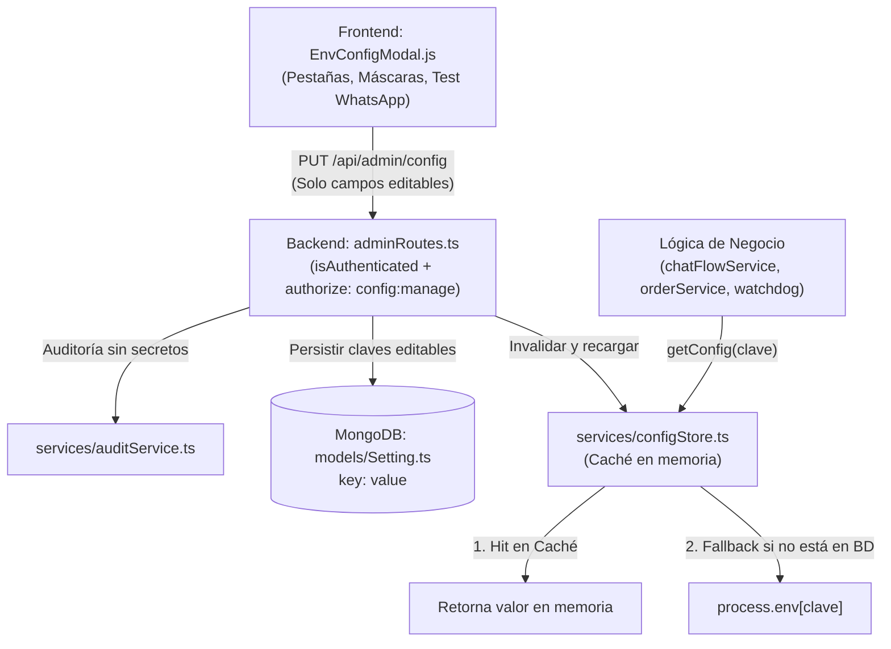

# Plan de Implementación: Modal de Variables de Entorno (Opción D Híbrida)

> **Origen:** `docs/tarea-variables-entorno.md` (Claude, Cerebro del proyecto)  
> **Ejecutor:** Antigravity (Senior TPM / Orquestador)  
> **Fecha:** 2026-10-23  
> **Estado:** Pendiente de Aprobación del Dueño  
> **Revisión 2 (2026-10-23):** corregidos tras verificación contra el código: lecturas a nivel de módulo, `BRAND_NAME` pasa a reinicio, migración de `WEBHOOK_DEBOUNCE_MS`, referencias exactas de `IG_ACCOUNT_ID`, fallback si falla `init()` y nota de CSRF.

---

## 1. Visión General y Arquitectura

El objetivo es permitir que administradores autorizados gestionen la configuración operativa del bot y de los canales (teléfonos de alerta, templates, IDs de cuenta, debounces) a través de una interfaz modal moderna y segura en el panel web, **sin tocar código, sin exponer secretos y sin necesidad de reiniciar Render**.

### Flujo de Datos



---

## 2. Clasificación Estricta de Variables

| Categoría | Variables | Comportamiento en Modal y Backend |
|---|---|---|
| **A. Editables (Almacenadas en `Setting`)** | `ADMIN_PHONE_NUMBER`, `ADMIN_PHONE_NUMBER_2`, `DELIVERY_PHONE_NUMBER`, `WHATSAPP_PHONE_NUMBER_ID`, `WHATSAPP_BUSINESS_ACCOUNT_ID`, `WHATSAPP_TEMPLATE_ORDER`, `WHATSAPP_TEMPLATE_REACTIVACION`, `IG_ACCOUNT_ID`, `FB_PAGE_ID`, `META_PIXEL_ID`, `META_DATASET_ID`, `META_CAPI_TEST_EVENT_CODE`, `VAPID_EMAIL`, `WEBHOOK_DEBOUNCE_MS`. | Inputs de texto editables en el modal. Se guardan en MongoDB vía `Setting`. `PUT` actualiza y refresca la caché en caliente. |
| **B. Solo Lectura de Estado (Secretos)** | `WHATSAPP_TOKEN`, `DEEPSEEK_API_KEY`, `OPENAI_API_KEY`, `GEMINI_API_KEY`, `GLADIA_API_KEY`, `DEEPGRAM_API_KEY`, `IG_ACCESS_TOKEN`, `FB_PAGE_ACCESS_TOKEN`, `META_CAPI_TOKEN`, `WHATSAPP_APP_SECRET`, `IG_APP_SECRET`, `FB_APP_SECRET`, `APP_SECRET`, `VAPID_PUBLIC_KEY`, `VAPID_PRIVATE_KEY`, `CLOUDINARY_API_SECRET`, `CLOUDINARY_API_KEY`, `JWT_SECRET`, `SESSION_SECRET`, `ADMIN_PASS`, `MONGODB_URI`, `VERIFY_TOKEN`, `IG_VERIFY_TOKEN`, `FB_VERIFY_TOKEN`, `ADMIN_USER`. | **NUNCA** se envían valores reales ni se guardan en `Setting`. La API devuelve exclusivamente un badge boolean: `{ configurado: true/false }`. Bloqueados contra escritura en `PUT`. |
| **C. Infraestructura / Arranque (Ocultas)** | `PORT`, `NODE_ENV`, `TZ`, `FORCE_CLEAN_SEED`, `META_APP_ID`, `APP_ID`, `CLOUDINARY_CLOUD_NAME`, `BRAND_NAME`. | No aparecen en el modal. Se gestionan en el dashboard de Render. `BRAND_NAME` se lee una sola vez en el constructor del singleton `services/configManager.ts:9`, así que requiere reinicio del servicio y no se puede cambiar en caliente. |

### Resoluciones Previas a Implementación (§3.D del Brief):
1. **`VAPID_PUBLIC_KEY` y `VAPID_PRIVATE_KEY`:** Solo lectura de estado (Categoría B) para evitar invalidar las suscripciones Push Web existentes en clientes.
2. **`ADMIN_USER`:** Solo lectura de estado (Categoría B) para evitar bloqueos accidentales de credenciales maestras.
3. **`PHONE_NUMBER_ID` y `WHATSAPP_PHONE`:** Confirmados como alias heredados. En `configStore.ts`, `getConfig("WHATSAPP_PHONE_NUMBER_ID")` resolverá con fallback a `process.env.PHONE_NUMBER_ID`, y `getConfig("WHATSAPP_PHONE")` a `getConfig("ADMIN_PHONE_NUMBER")`.
4. **`BRAND_NAME`:** pasa a categoría C (reinicio requerido). Ver nota en la tabla de §2.

### Regla transversal: lectura en tiempo de ejecución
Un valor que se lee al cargar el módulo (`const X = process.env.X;` en el nivel superior del archivo) no reacciona a cambios en caliente. Cada migración de la Fase 4 debe mover la lectura **dentro de la función** que la usa, o llamar a `getConfig` en ese punto. No basta con sustituir la expresión en la constante.

---

## 3. Plan de Tareas Paso a Paso

### Fase 1: Capa de Seguridad y Permisos
- [ ] **Paso 1.1: Agregar permiso granular `config:manage` en `data/permissions.js`**
  - Asignar `"config:manage"` a `PERMISSIONS.admin`.
  - Asegurar que `cajero` y `repartidor` NO tengan acceso.
- [ ] **Paso 1.2: Validar middleware `authorize`**
  - Verificar que solicitudes a `/api/admin/config` sin el permiso `config:manage` respondan `403 Forbidden`.

---

### Fase 2: Módulo Central `services/configStore.ts` y Pruebas Unitarias
- [ ] **Paso 2.1: Crear `services/configStore.ts`**
  - Implementar Singleton con `cache: Map<string, any>` o `Record<string, any>`.
  - Integrar mock de test condicional:
    ```typescript
    let Setting = require("../models/Setting");
    if (process.env.NODE_ENV === "test") {
      Setting = require("./dbLocal").getSettingModel();
    }
    ```
  - Métodos expuestos:
    - `init(): Promise<void>`: Precarga en memoria todas las claves editables desde MongoDB. Si MongoDB no responde, registra el error con `console.error`, deja la caché vacía y **no lanza**: el sistema sigue funcionando con `process.env` (modo degradado). Reintentar la precarga en la primera lectura o cada 60 s.
    - `getConfig(key: string): any`: Búsqueda síncrona en memoria con fallback a `process.env[key]`. Retorna `undefined` si no existe (nunca arroja error).
    - `setConfig(key: string, value: any): Promise<void>`: Guarda en `Setting` vía `findOneAndUpdate` con `{ upsert: true }` y actualiza la caché local.
    - `getAllConfig(): Promise<{ editables: Record<string, any>, estadoSecretos: Record<string, boolean> }>`: Prepara la carga para el frontend sin exponer secretos.
    - `invalidateCache(): void`: Limpia la memoria para pruebas y recarga.
- [ ] **Paso 2.2: Crear suite automatizada `scripts/test-config-store.ts`**
  - Ejecutar con `NODE_ENV=test npx tsx scripts/test-config-store.ts`.
  - Casos de prueba obligatorios:
    1. Retorno de valor desde `process.env` cuando no existe en `Setting`.
    2. Prioridad de `Setting` sobre `process.env` tras persistencia.
    3. Invalidación y actualización inmediata de la caché en memoria.
    4. Comprobación de que `getConfig("CLAVE_INEXISTENTE")` retorna `undefined` sin lanzar excepciones.
    5. Rechazo estricto de claves de secretos en modificaciones.

---

### Fase 3: Endpoints Administrativos y Auditoría
- [ ] **Paso 3.1: Crear controlador `controllers/configAdminController.ts`**
  - `getConfigAdmin(req, res)`: Invoca `configStore.getAllConfig()` y devuelve estructura categorizada para el frontend.
  - `updateConfigAdmin(req, res)`:
    - Valida payload (solo claves permitidas de Categoría A).
    - Aplica `trim()` a todas las cadenas de texto.
    - Ignora o rechaza cualquier intento de sobreescribir claves de Categoría B (secretos).
    - Persiste en `configStore.setConfig`.
    - Registra evento en `services/auditService.ts` (`tipoRecurso: "config"`, `accion: "update"`, sin valores de secretos).
  - `testWhatsAppConnection(req, res)`:
    - Realiza una consulta `GET` interna con `axios` a Meta Graph API (`https://graph.facebook.com/v20.0/${phoneId}`) usando el token del backend.
    - Responde `{ success: true, verifiedName: "..." }` o `{ success: false, error: "..." }` sin exponer el token.
- [ ] **Paso 3.2: Montar rutas en `routes/adminRoutes.ts`**
  - `GET /config` → `isAuthenticated`, `authorize(["config:manage"])`, `configAdminController.getConfigAdmin`
  - `PUT /config` → `isAuthenticated`, `authorize(["config:manage"])`, `configAdminController.updateConfigAdmin`
  - `POST /config/test-whatsapp` → `isAuthenticated`, `authorize(["config:manage"])`, `configAdminController.testWhatsAppConnection`

---

### Fase 4: Migración Gradual de Lecturas en el Código
- [ ] **Paso 4.1: Inicializar `configStore` en el arranque de la app**
  - En `index.ts`, invocar `await configStore.init()` antes de levantar listeners de webhooks o cron jobs.
- [ ] **Paso 4.2: Migrar lecturas de teléfonos de alerta**
  - `services/chatFlowService.ts`: Migrar líneas 1838-1839 a `getConfig("ADMIN_PHONE_NUMBER")` y `getConfig("ADMIN_PHONE_NUMBER_2")`.
  - `services/orderService.ts`: Migrar líneas 613-614 a `getConfig(...)`.
  - `services/watchdogService.ts`: Migrar líneas 119-120, 170-171, 217-218 y 545 a `getConfig(...)`.
  - `controllers/adminController.ts`: Las líneas 58-59 son constantes de nivel de módulo (`const ADMIN_PHONE = ...`, `const DELIVERY_PHONE = ...`). Eliminarlas y leer `getConfig("ADMIN_PHONE_NUMBER")` / `getConfig("DELIVERY_PHONE_NUMBER")` dentro de las funciones que las usan. Migrar también 1635-1636, 2109-2110 y 3169-3170 a `getConfig(...)`. No tocar la línea 60 (`WHATSAPP_TOKEN`, categoría B).
  - `services/chatFlowService.ts` y `services/instagramFlowService.ts`: migrar `WEBHOOK_DEBOUNCE_MS` (`chatFlowService.ts:60`, `instagramFlowService.ts:365`) a `getConfig("WEBHOOK_DEBOUNCE_MS")`. Ya se lee dentro de función, así que no requiere más cambios.
  - `controllers/webhookController.ts`: Migrar línea 189 a `getConfig(...)`.
  - `controllers/botController.ts`: Migrar línea 59 a `getConfig(...)`.
- [ ] **Paso 4.3: Migrar plantillas y cuentas de mensajería**
  - `services/whatsapp.ts`: Migrar líneas 517 y 568 (`WHATSAPP_TEMPLATE_ORDER`) a `getConfig("WHATSAPP_TEMPLATE_ORDER")`.
  - `services/inbox/adapters/instagramAdapter.ts:249` y `:306`, y `services/instagram.ts:31` y `:100`: migrar `process.env.IG_ACCOUNT_ID` a `getConfig("IG_ACCOUNT_ID")`.

---

### Fase 5: Actualización de `.env.example`
- [ ] **Paso 5.1: Documentar las 12 claves faltantes en `.env.example`**
  - Añadir con comentarios explicativos: `PHONE_NUMBER_ID`, `WHATSAPP_PHONE`, `WHATSAPP_TEMPLATE_REACTIVACION`, `WEBHOOK_DEBOUNCE_MS`, `META_CAPI_TEST_EVENT_CODE`, `META_DATASET_ID`, `META_APP_ID`, `FB_APP_SECRET`, `APP_SECRET`, `APP_ID`, `FORCE_CLEAN_SEED`, `BRAND_NAME`.

---

### Fase 6: Frontend - Componente `EnvConfigModal.js`
- [ ] **Paso 6.1: Crear `public/src/features/dashboard/components/EnvConfigModal.js`**
  - Construido con React 18 (`React.createElement`), Tailwind CSS y `apiClient.js`.
  - Pestañas organizadas:
    1. **WhatsApp & Meta:** Phone ID, Business Account ID, Plantillas, botón *"Probar Conexión WhatsApp"*.
    2. **Instagram & Messenger:** IG Account ID, FB Page ID, estado de tokens en badges.
    3. **Alertas & Teléfonos:** Teléfonos de Admin 1, Admin 2, Delivery y Debounce de Webhooks.
    4. **Tracking & Conversiones:** Meta Pixel ID, Dataset ID, Test Event Code.
    5. **Avanzado & Estado:** Resumen de estado de secretos (indicadores verdes/grises *"Configurado en Render"* / *"Pendiente"*).
  - Manejo de estados de carga, spinners, trim automático al guardar y toasts de confirmación.
- [ ] **Paso 6.2: Integrar disparador en `SettingsPanel.js`**
  - Añadir tarjeta/botón *"Configuración de Canales y Variables"* visible solo para usuarios con `user.role === 'admin'`.
  - Gestionar apertura/cierre del modal sin alterar `features/whatsapp/**` ni `features/instagram/**`.
- [ ] **Paso 6.3: Validación de empaquetado frontend**
  - Ejecutar verificación:
    ```bash
    npx esbuild public/src/features/dashboard/components/EnvConfigModal.js --bundle --format=esm --external:https://* --outfile=/dev/null
    npx esbuild public/src/features/dashboard/SettingsPanel.js --bundle --format=esm --external:https://* --outfile=/dev/null
    ```

---

## 4. Matriz de Riesgos y Mitigación

| Riesgo | Probabilidad | Impacto | Estrategia de Mitigación |
|---|---|---|---|
| **Fuga accidental de tokens en API** | Baja | Crítico | El controlador solo mapea un array de claves públicas permitidas. Los secretos NUNCA se extraen de `process.env` hacia el payload de respuesta; solo se devuelve `Boolean(process.env[key])`. |
| **Incompatibilidad con Mocks de Test (`dbLocal.ts`)** | Media | Alto | `configStore.ts` detectará `NODE_ENV === "test"` y usará `dbLocal.getSettingModel()`, garantizando que todas las suites de CI/CD funcionen en memoria sin requerir MongoDB real. |
| **Pérdida de configuración en redeploy de Render** | Nula | Crítico | Al persistir en MongoDB (`Setting`), los datos sobreviven a reinicios efímeros de contenedores. |
| **Bloqueo o desincronización de llamadas síncronas** | Baja | Medio | La caché en memoria permite que `getConfig(key)` se ejecute de manera instantánea y síncrona sin ralentizar el event loop ni obligar a convertir funciones a `async`. |
| **Violación de regla de Git** | Nula | Alto | No se ejecutarán comandos de escritura git (`commit`, `add`, `push`). Todos los cambios quedarán en el working tree para revisión del dueño. |
| **CSRF en `PUT /api/admin/config`** | Media | Alto | La autenticación va por cookie. Verificar que la cookie de sesión use `SameSite=Strict` o `Lax`. Un `PUT` con `Content-Type: application/json` desde otro origen exige preflight CORS, que no se concede a orígenes ajenos. Confirmar en `index.ts` la configuración de CORS y de la cookie antes de cerrar la Fase 3. Si hay duda, exigir una cabecera personalizada (p. ej. `X-Requested-With`) en el `PUT`. |
| **Lectura de variable al cargar el módulo** | Media | Alto | Regla transversal de §2: ninguna migración deja `const X = process.env.X` a nivel de módulo. Revisión con `grep -n "^const .*process\.env" services controllers routes middlewares` antes de cerrar la Fase 4. |
| **MongoDB caído al arrancar** | Baja | Medio | `init()` degrada a `process.env` sin lanzar (ver Paso 2.1). |

---

## 5. Verificaciones Finales de Entrega

1. `npx tsc --noEmit` sin errores de compilación TypeScript.
2. Ejecución exitosa de `scripts/test-config-store.ts`.
3. Verificación de no-regresión ejecutando las suites principales con `tsx` (con `node` directo fallan con "Cannot find module" porque importan módulos `.ts`): `NODE_ENV=test npx tsx scripts/test-resilience.js` y `NODE_ENV=test npx tsx scripts/test-inbox-service.js`.
4. Verificación de bundle de los módulos tocados con `esbuild`.
5. Registro en el historial de `AGENTS.md` con la firma `— Ejecutado por **Antigravity**`.
